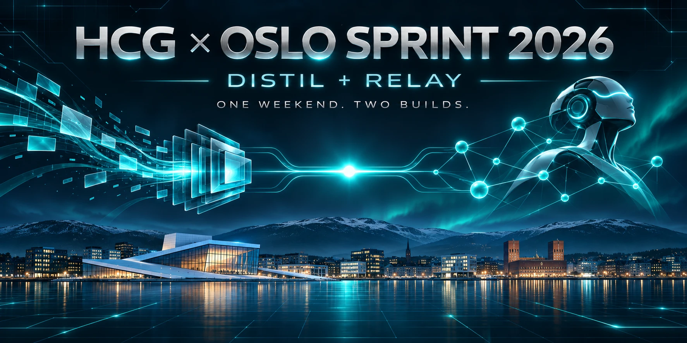

# Oslo-Sprint

Programs made during Oslo Sprint 2026. Each product is a self-contained Swift package in its own folder, and the two share no code.

| Folder | Product | What it is |
|---|---|---|
| [`distil/`](distil/README.md) | **Distil** | macOS app that selects the context a model needs for a task. It shows every decision and compares answers from the full and the reduced prompt. [Read the Distil README](distil/README.md) · [screenshots](distil/README.md#screenshots) |
| [`relay/`](relay/README.md) | **Relay** | macOS technical assistant for the Wybe Night Shift, Holio warehouse and ElevenLabs side challenges, with a headless runner. [Read the Relay README](relay/README.md) · [screenshots](relay/README.md#screenshots) |

Both names are working names.

## Requirements

- macOS 14 or later and Xcode 15 or later (Swift 5.9+) for the macOS apps.
- The core libraries and tests of both products also build with any Swift 5.9+ toolchain on Linux.
- No third-party packages are used.

## Build and test

**Distil**

```sh
cd distil
swift test                       # core tests
bash scripts/run-latest.sh       # build dist/Distil.app, quit any running copy, open the new one
swift run Distil                 # run from SwiftPM (macOS)
```

In Xcode, open `distil/Package.swift` and run the **Distil** scheme. The internal package and module names are still `TokenLab*`; the bundle identifier is unchanged.

**Relay**

```sh
cd relay
./scripts/test.sh                # swift build + swift test
./scripts/build-app.sh           # local build/Relay.app with microphone usage text
swift run Relay                  # run the app from Terminal (macOS)
swift run relay-runner help      # headless runner (macOS or Linux)
```

Each product's README has full instructions, its verification status, its limitations and a first-launch checklist.

## Status

- **Linux:** the core libraries and tests of both products build and pass on Linux.
- **macOS:** GitHub Actions also builds both macOS apps on a macOS 15 runner, launches them and saves window screenshots ([`.github/workflows/`](.github/workflows/)). The screenshots in each product README come from those runs.
- **Not yet tested on a Mac:** interaction, speech, and accessibility have not been checked by a person on a Mac.

See each product's README for details.

## Working here

- All Distil work goes in `distil/` and all Relay work goes in `relay/`.
- Keep each product's source, tests, scripts and documentation inside its folder. Shared repository files belong at the root.
- Never commit credentials, build output (`.build/`, `build/`, `dist/`) or local settings. For Relay, run `relay/scripts/check-no-secrets.sh` before committing.
