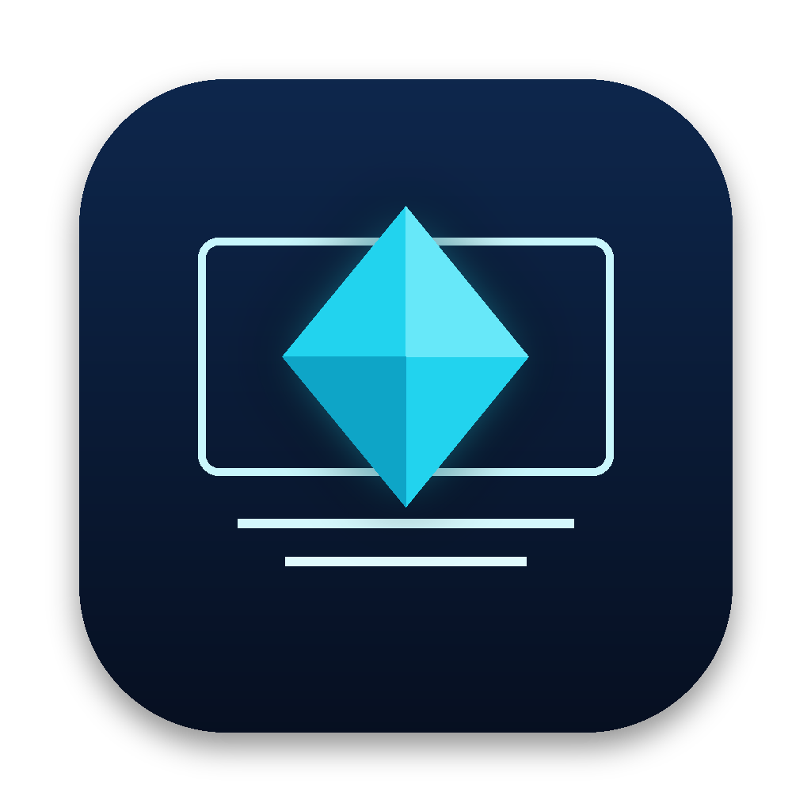

# Presentation Studio: macOS

No build uploaded yet.

A macOS (Apple Silicon) build exists, but it is **not in this folder**. Its ZIP is 117 MB, and GitHub rejects files over 100 MB in a normal push (see [Adding a build](../../README.md#adding-a-build)). You can get the build in two ways:
- the `desktop-macos` job of the [Presentation Studio workflow](../../../.github/workflows/presentation-studio.yml) uploads the `.app` ZIP and DMG as the run artifact `presentation-studio-macos`;
- build it yourself with the commands under [Build it yourself](#build-it-yourself).

Build made in the development session, **not uploaded**:

| File | Version | Architecture | Build date | Source commit | Verification status |
|---|---|---|---|---|---|
| `Presentation-Studio-0.1.0-mac-arm64.zip` (117 MB, SHA-256 `523ef8033843425c44702435fd75300a901d9101caf0fa4072af0cd522b733b8`) | 0.1.0 | arm64 | 2026-11-08 | `3209380` (built from this commit's app source just before it was committed) | Cross-built on Linux and ad-hoc signed with rcodesign; bundle structure checked. **Not launched on a Mac: not verified.** The same app packaged for Linux passed the 15-step end-to-end test. |

That ZIP was made on Linux with `zip -y`, which keeps the framework symlinks. A build made on a Mac (`npm run desktop:dist:mac`, or the CI job) uses electron-builder's own ZIP and DMG.

**About the app.** Presentation Studio is a desktop app that turns your images and a brief into an editable PowerPoint deck. It is a standalone Electron app. Double-click it in Finder and it opens its own window. It needs no Terminal, browser tab, development server or separate Node/npm install. Source: [`presentation-studio/`](../../../presentation-studio/).

## Status at a glance

| | Result |
|---|---|
| macOS arm64 `.app` and ZIP built | **Yes**, cross-built on Linux and ad-hoc signed with rcodesign (details below). |
| Same app packaged and tested end to end | **Yes**, on Linux: 15/15 checks, twice (with and without a secure key store). |
| Launched on a real Mac | **No.** No Mac was available in this environment. The macOS CI job that does this is written but **has not run** (the work is committed, not pushed). |
| DMG | **Not built here.** DMGs need macOS (`hdiutil`). `npm run desktop:dist:mac` on a Mac, or the CI job, builds it. |

## Install and launch

**Requires** macOS 12 Monterey or later on Apple Silicon (M1 or newer).

1. Unzip `Presentation-Studio-0.1.0-mac-arm64.zip`, or open the DMG, and move **Presentation Studio.app** to **Applications**.
2. The app is ad-hoc signed and **not notarized**. The first time, Control-click (right-click) it in Finder and choose **Open**, then **Open** again. After that, double-click works as usual.
   - If macOS says the app "is damaged and can't be opened", the download was quarantined. Remove the flag once: `xattr -dr com.apple.quarantine "/Applications/Presentation Studio.app"`
3. Presentation Studio opens its own window. Everything works offline except AI generation and voice, which call their providers.

**Optional providers.** Open **Setup** (the *AI · Voice* button in the top bar, or **Presentation Studio › Setup & Providers…**, ⌘,). Paste an Anthropic key (AI slide writing) and/or an ElevenLabs key (spoken brief and narration), then click **Verify connection**. Without keys you can still import images, build a deck from a template, edit, present, save, reopen and export PowerPoint. Setup explains what each key enables and links to the official key pages.

## What the app does

- **Images:** File › Import Images… (⌘I) opens the native picker, or drag images onto the window. PNG, JPEG and WebP are accepted; files are checked by content, not by extension. Originals are kept byte-for-byte.
- **Brief and generation:** AI generation (Anthropic) when a key is saved, or template mode without AI.
- **Editor:** reorder, duplicate and delete slides; seven layouts; fit/fill/crop images; speaker notes; overflow warnings.
- **Projects:** File › Save Project (⌘S) uses the native save dialog the first time, then saves in place. Save Project As… is ⇧⌘S. Open Project… is ⌘O. Projects are `.pstudio` files and include images and narration audio.
- **Export:** File › Export PowerPoint… (⌘E) writes an editable `.pptx` through the native save dialog. *Export › PowerPoint + narration (.zip)* appears once slides have narration.
- **Present:** ⌘↵ or **▶ Present**, with optional narration playback.
- **Voice (ElevenLabs):** spoken brief (records only while you choose to; macOS asks for microphone permission the first time) and per-slide narration.

## Where things are stored

| What | Where |
|---|---|
| Settings (model names, encrypted keys) | `~/Library/Application Support/Presentation Studio/settings.json` |
| Encryption key protecting the API keys | macOS Keychain item **"Presentation Studio Safe Storage"** (Electron `safeStorage`) |
| Diagnostic log (no keys, no content) | `~/Library/Application Support/Presentation Studio/logs/main.log` |
| Your projects and exports | Wherever you choose in the save dialog (Documents by default) |

**To uninstall:** delete the app, the `~/Library/Application Support/Presentation Studio` folder, and the Keychain item above.

## How it is built

| | |
|---|---|
| Runtime | Electron 45.2.3 (bundled Chromium and Node; nothing else to install) |
| Backend | The project's Express API runs **inside the app process** on `127.0.0.1`, on a port the OS picks at each launch. It starts with the app and stops when the app quits, so there is no separate process to orphan and no fixed port to conflict. |
| API protection | Every API call needs a per-launch random token. The app's main process adds it to requests from its own window, so other programs and web pages cannot use the local API or spend your provider credits. |
| Renderer | Sandboxed, context-isolated, no Node integration, strict Content Security Policy, navigation locked to the app. External links open in your browser only for the provider setup sites. |
| Desktop operations | Exposed through a small preload bridge: open/save/export dialogs, image import, credentials, menu commands. Every request is checked to come from the app's own page and is validated, and file paths always come from a native dialog. |
| Keys | Entered in Setup; encrypted with `safeStorage` (Keychain) before being written. The page can set or remove a key but never read it back. Keys are never bundled, logged, or written into projects or exports. No `.env` file is read. |
| Single instance | Opening the app a second time focuses the running window instead of starting another backend. |
| Unsaved changes | Closing the window with unsaved changes asks first. |
| Startup errors | If the built-in server can't start, the window shows the error with **Try again**, **Show log** and **Quit**. |
| Packaging | electron-builder 26.18.0. Everything is pre-bundled with esbuild (`desktop-dist/main.mjs`) and Vite (`dist/`), so the app ships no `node_modules`. |
| Electron fuses | RunAsNode off, NODE_OPTIONS off, only loads its own `app.asar`, cookie encryption on. Inspector flags stay enabled so the automated test can drive the packaged app. |
| Bundle | `com.oslosprint.presentationstudio`, version 0.1.0, `LSMinimumSystemVersion` 12.0, category Productivity, `NSMicrophoneUsageDescription` set, icon `icon.icns`. |
| Signing | Ad hoc (no Apple Developer ID). Not notarized. |

**Icon.** No Presentation Studio icon was supplied anywhere in this repository or on this machine. `app-icon.png` was drawn to match the in-app ◆ logo by `presentation-studio/scripts/make-icon.py`. To use another icon, replace `presentation-studio/desktop/build/icon.icns` and `icon.png`, then rebuild.

## Build it yourself

From `presentation-studio/`:

| Goal | Command | Output |
|---|---|---|
| Run the desktop app from source | `npm install`, then `npm run desktop:start` | Opens the app window |
| Build `.app` + ZIP + DMG **on a Mac** | `npm run desktop:dist:mac` | `release/mac-arm64/Presentation Studio.app`, `release/Presentation-Studio-0.1.0-mac-arm64.zip`, `release/Presentation-Studio-0.1.0-arm64.dmg` |
| Build `.app` + ZIP **on Linux** (no DMG) | `cargo install apple-codesign --locked`, then `npm run desktop:dist:mac-on-linux` | `.app` and ZIP, ad-hoc signed with rcodesign |
| Package for the current OS (test build) | `npm run desktop:pack` | `release/<os>-unpacked/` |
| Test the packaged app | `npm run test:desktop` (Linux: `xvfb-run -a npm run test:desktop`) | `test-output/desktop/` (results and screenshots) |

The build artifacts are not committed (the ZIP is 117 MB). This session's build produced `presentation-studio/release/Presentation-Studio-0.1.0-mac-arm64.zip`, SHA-256 `523ef8033843425c44702435fd75300a901d9101caf0fa4072af0cd522b733b8`.

## Verification

### Verified in this environment (Linux container, Electron 45.2.3, Xvfb)

The packaged app (electron-builder `--dir`, with the same `app.asar` and fuses as the Mac build) was driven by `e2e/desktop-e2e.mjs`: **15/15 passed** without a secure key store, and **15/15 passed** with a Secret Service keyring.

1. No development server running (ports 5173 and 8787 free, no app process running).
2. Launches, opens its own window titled *Presentation Studio*, served from `127.0.0.1` on an OS-chosen port. `app.isPackaged` is true.
3. The renderer has no `require` or `process`. The bridge exposes exactly its 13 documented members. The API returns **403** to a caller outside the window, and 200 inside it.
4. **No keys:** Setup shows the guidance and key fields with no `.env` instructions. AI generation is disabled, the spoken brief says it is not configured, and manual work continues.
5. **Import images** through the native open dialog: PNG, JPEG and WebP accepted; a text file named `.png` rejected with a message.
6. Template deck built, then edited, a slide added and slides reordered.
7. **Save** through the native save dialog produces a valid `.pstudio`. A second **Save** writes in place without a dialog.
8. **New**, then **Open** the saved project through the native open dialog: title, slide order, text and notes restored.
9. **Export PPTX** through the native save dialog. The file opens in python-pptx (6 slides, edited text, notes, WebP exported as PNG) and LibreOffice converts it to PDF.
10. Presentation mode opens, navigates and closes.
11. **In-app keys** (against local **mock** Anthropic and ElevenLabs servers): an invalid key is rejected with a message; valid keys are saved and both connections verify. The page cannot read a key, and `settings.json` contains no plain-text key.
12. The startup-error page renders inside the app, and its CSP-hashed script runs.
13. A second launch exits and hands over to the running window, so there is one backend.
14. **Quit:** the backend port closes, no app processes remain, and the log records "backend stopped" with no keys in it.
15. **Relaunch:** with the keyring, keys persist encrypted. Without secure storage, keys are gone after quit, as designed.

Also verified here:
- 47 unit and API tests, including the token gate, CSP and runtime key changes.
- The web-mode browser e2e (25/25).
- The macOS bundle structure: arm64 Mach-O, Info.plist keys, icon, helper apps, fuses, and an ad-hoc code directory with the right identifier.
- The `app.asar` contains only the bundles (no `node_modules`, no source, no keys).
- The ZIP keeps symlinks.

Screenshots in [`screenshots/`](screenshots/) are from the **Linux** packaged build of the same app. The window contents are identical on macOS; only the window frame differs.

### Blocked by the environment (not verified)

- **Launching on macOS.** That covers Gatekeeper behaviour of the ad-hoc signature from rcodesign, the Keychain prompt and storage, the microphone permission prompt, native menus and dialogs, and Finder double-click. rcodesign's own `verify` command is marked by its authors as unreliable and errors on ad-hoc signatures, so `codesign --verify --deep --strict` on a Mac is still needed.
- **DMG** (needs macOS).
- **macOS screenshots** (need a Mac).
- **Real Anthropic and ElevenLabs calls** (no keys; tested against mock servers).
- **Opening the export in Microsoft PowerPoint.**

### How to close the gap

Push the branch. The `desktop-macos` job in `.github/workflows/presentation-studio.yml` runs on a macOS 15 Apple Silicon runner. It:
1. builds the `.app`, ZIP and DMG with Apple's `codesign`;
2. checks them with `codesign --verify --deep --strict`, `plutil`, `lipo`, `hdiutil verify` and `unzip -t`;
3. opens the app through LaunchServices with `open`, as Finder does, using the repository's existing `launch-check.sh`, and checks that it stays up with no crash report;
4. checks that no processes remain;
5. runs the same 15-step end-to-end test against the Mac build;
6. saves a window screenshot;
7. uploads the DMG, ZIP, screenshots and results.

A `desktop-linux` job repeats the Linux results above.

## HCG Executable Maker

Maker cannot build this app yet: it recognises Electron projects but reports them as unsupported. See [EXECUTABLE-MAKER-HANDOFF.md](EXECUTABLE-MAKER-HANDOFF.md) for the evidence and the exact adapter changes Maker would need.

Back to [Presentation Studio submissions](../README.md).
